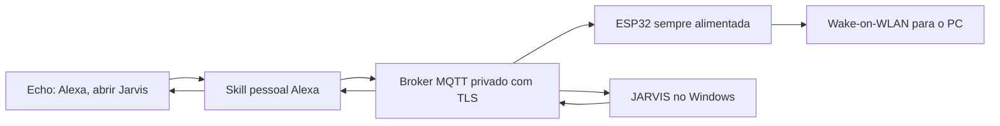

# Alexa + JARVIS pessoal

Esta integração usa a Alexa como interface de voz e mantém o computador fora
da internet. A Alexa envia somente o texto do pedido reconhecido; o JARVIS não
recebe o áudio bruto do Echo e não usa a voz da Alexa como biometria.



## O que já está no projeto

- Skill personalizada em português brasileiro: modelo de interação em
  `integracoes/alexa/interactionModels/custom/pt-BR.json`.
- Mensagens MQTT assinadas, com prazo máximo de 90 segundos, identificador de
  pedido e proteção contra repetição.
- A ESP32 aceita somente o pedido assinado de despertar e responde que enviou
  o pacote. Isso não é tratado como prova de que o PC acordou.
- O Windows só executa comandos permitidos pelo JARVIS e mantém confirmações
  perigosas no mesmo canal. A tela de bloqueio continua bloqueando comandos.
- O comando de despertar é retido por até 90 s para chegar ao JARVIS quando o
  Windows volta da suspensão.

## Preparação local

Crie um broker MQTT privado com TLS na porta 8883. O projeto bloqueia brokers
públicos. Para uso pessoal, o plano Serverless gratuito da EMQX é uma opção;
configure limite de gastos em zero antes de criar as credenciais. Baixe o
certificado CA que o broker indicar para clientes MicroPython.

No PowerShell, sem enviar senhas para o chat:

```powershell
cd .
.venv\Scripts\python.exe -m integracoes.alexa.preparar --preparar
.venv\Scripts\python.exe -m integracoes.alexa.preparar --empacotar
```

O primeiro comando pede, no próprio computador, o ID da skill, o ID da sua
conta Alexa autorizado, host, usuário e senha MQTT e o caminho do certificado
CA. Ele gera chaves aleatórias diferentes para PC e ESP32 em arquivos ignorados
pelo Git. Não mostre nem copie esses arquivos em conversas.

Depois de preparar, instale na placa que já estiver alimentada fora do PC:

```powershell
cd .
.venv\Scripts\python.exe integracoes\alexa\instalar_esp32.py --porta COM7 --instalar
```

O instalador salva uma cópia do `main.py` atual antes de trocar arquivos,
instala o cliente MQTT oficial do MicroPython, a configuração privada e o
certificado. Ele reinicia a placa no final.

## Console da Alexa

1. Na skill **JARVIS Pessoal**, abra **Build** e substitua o JSON do modelo pelo
   arquivo `pt-BR.json`; salve e faça **Build Model**.
2. Na aba **Code**, substitua os arquivos do template por `lambda_function.py`,
   `mqtt_conexao.py` e `alexa_protocolo.py` que estão no pacote
   `integracoes/alexa/jarvis-alexa.zip`; mantenha `requirements.txt` com
   `paho-mqtt==2.1.0`.
3. Depois de preparar os segredos, gere o pacote do código hospedado diretamente
   no computador:

   ```powershell
   .venv\Scripts\python.exe -m integracoes.alexa.preparar --empacotar-hosted
   ```

   Envie `integracoes/alexa/alexa-hosted-code-configurado.zip` na aba **Code**
   e faça o deploy. Esse ZIP inclui `config_local.json`, que contém credenciais
   e chaves; confirme o destino antes do upload e não o compartilhe.
4. Reinicie o JARVIS no Windows após o arquivo `dados/alexa.json` existir.

O ID da skill aparece no cabeçalho da configuração da skill. O ID de usuário
Alexa é obtido no JSON de uma requisição de teste no console; ele entra na lista
de usuários permitidos. Sem ambos, a skill responde que ainda não está vinculada.

## Como falar

Use inicialmente:

> Alexa, abrir Jarvis

Depois da resposta de conexão, diga por exemplo:

> Alexa, peça ao Jarvis para verificar a temperatura do quarto

Se uma ação exigir confirmação, responda “sim” ou “não” enquanto a conversa da
skill ainda estiver aberta. Isso não libera a tela local do JARVIS.

## Teste físico final

1. Salve seu trabalho e deixe a ESP32 em fonte USB independente.
2. Com o PC acordado, diga o comando e confirme que a ESP32 registra o pedido.
3. Coloque o PC em suspensão S3 e repita.
4. Só considere Wake-on-WLAN aprovado quando a tela do PC voltar fisicamente.

O adaptador Wi-Fi e a BIOS podem recusar despertar mesmo com a ESP32 e a skill
corretas. O broker e os testes automatizados provam comunicação, não substituem
esse teste de suspensão.

## Referências

- [Custom skills da Alexa](https://developer.amazon.com/en-US/alexa/alexa-skills-kit/get-deeper/custom-skills)
- [Alexa-hosted skills](https://developer.amazon.com/en-US/docs/alexa/hosted-skills/build-a-skill-end-to-end-using-an-alexa-hosted-skill.html)
- [Regras para nome de invocação](https://developer.amazon.com/en-US/docs/alexa/custom-skills/choose-the-invocation-name-for-a-custom-skill.html)
- [EMQX Serverless](https://www.emqx.com/en/cloud/serverless-mqtt)
